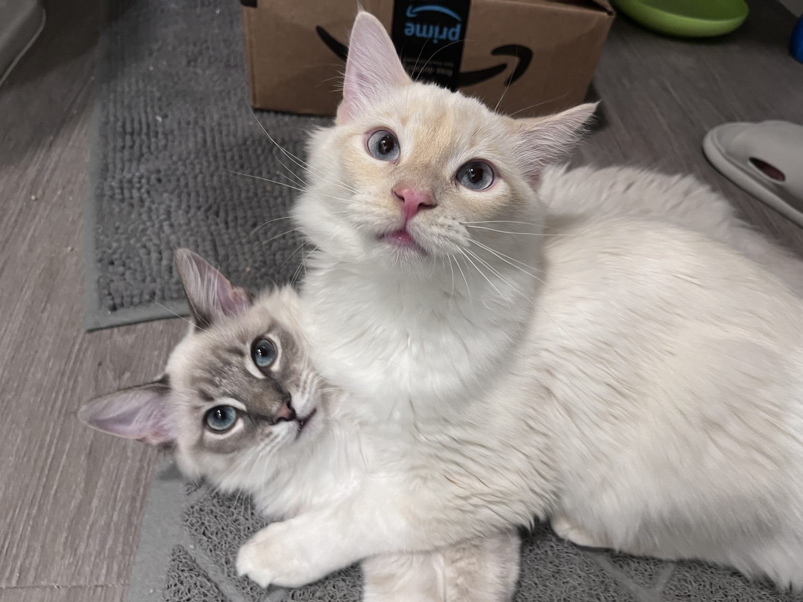
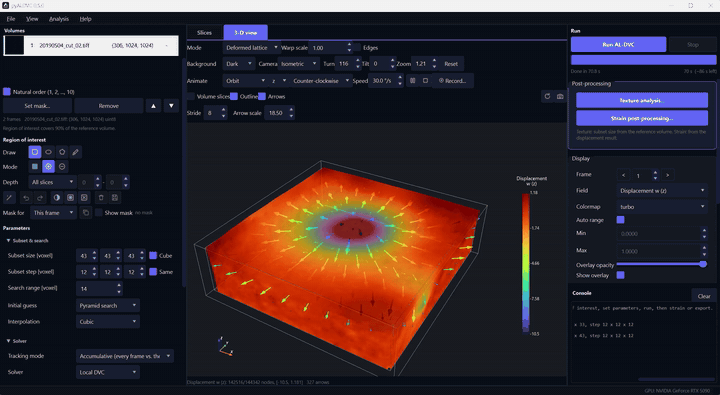
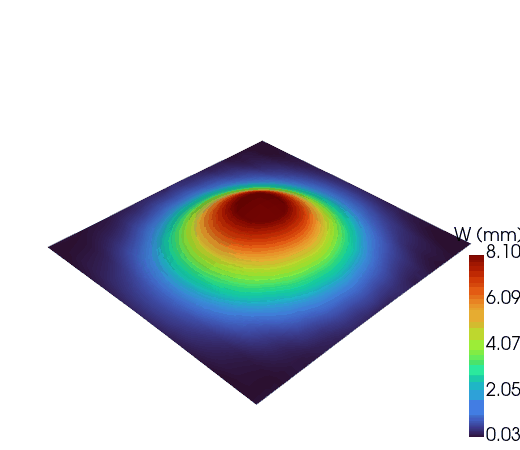
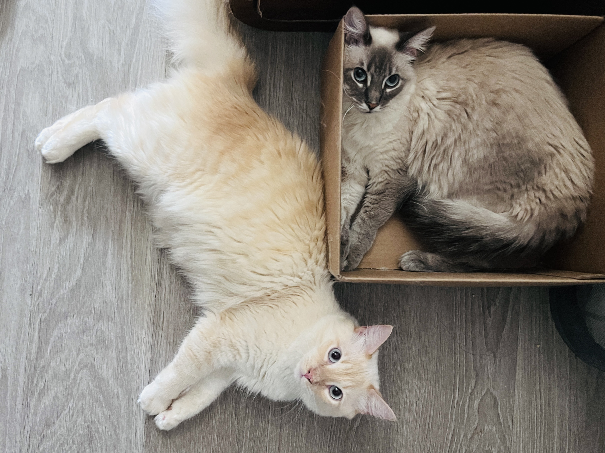

---

<table>
  <tr>
    <td width="65%">

**PhD candidate in Engineering Mechanics** at The University of Texas at Austin, working in the [Yang Research Group](https://sites.utexas.edu/yang/).

My research focuses on advancing **Digital Image/Volume Correlation (DIC/DVC)** under extremely challenging conditions — complex geometry, large deformation, and biological tissues. I combine **Machine Learning** and **Computer Vision** to build open-source tools that make high-accuracy deformation measurement accessible to the experimental mechanics community, and I use the fields they produce to validate and calibrate finite element models.

*When I'm not correlating pixels, I'm hanging out with my Siamese cats* :point_right:

:globe_with_meridians: [**zachtong.github.io**](https://zachtong.github.io/)

   </td>
    <td width="35%" align="center">
      
       
      <em>Lab supervisors (unofficial)</em>
    </td>
  </tr>
</table>

---

## Tech Stack

---

## Featured Publications & Software

<table>
  <tr>
    <td>
      <strong><a href="https://arxiv.org/abs/2607.22755">pyALDIC: A Python Implementation of Augmented Lagrangian Digital Image Correlation with a GUI, Adaptive Meshing, and Mask-Aware Subset Splitting</a></strong>
       
      
      
      
      
      
       
      A fully open-source Python port of AL-DIC with an integrated desktop GUI, quadtree-refined meshes, starting-point propagation for large-displacement and discontinuous fields, and dual Local-DIC / AL-DIC solvers — pip-installable and ready for experimental mechanics workflows.
    </td>
  </tr>
  <tr>
    <td>
      <strong><a href="https://github.com/zachtong/pyALDVC">pyALDVC: Augmented Lagrangian Digital Volume Correlation in Python</a></strong>
       
      
      
      
       
      The volumetric sibling of pyALDIC: full-field 3D displacement and strain from micro-CT, confocal, MRI and OCT scans, with GPU acceleration, boundary-aware subsets that keep cracks and holes sharp, texture analysis that measures the scan and recommends the subset size, and an interactive 3D viewer.
    </td>
  </tr>
  <tr>
    <td>
      <strong><a href="https://github.com/zachtong/pyALDIC-3D">pyALDIC-3D: Stereo Augmented Lagrangian Digital Image Correlation in Python</a></strong>
       
      
      
      
      
       
      Two-camera stereo-DIC from calibration to export in a single desktop application: metric 3D shape, displacement and Green-Lagrange surface strain in millimetres, AL-DIC tracking on an adaptive quadtree mesh, and crack-aware meshing that keeps a displacement jump from being smeared into a continuous field.
    </td>
  </tr>
  <tr>
    <td>
      <strong><a href="https://arxiv.org/abs/2609.01876">RAFT-DVC: Resolution-Aware Machine Learning-Based Digital Volume Correlation</a></strong>
       
      
      
      
      
       
      A 3D adaptation of the RAFT optical-flow architecture for DVC, released as three resolution arms matched to particle size and displacement band, with an explicit rule for choosing between them and benchmarks against tuned classical DVC solvers.
    </td>
  </tr>
  <tr>
    <td>
      <strong><a href="https://www.researchsquare.com/article/rs-9452500/v1">RAFTcorr: A Deep Learning Digital Image Correlation Framework with Operating-Boundary Characterization</a></strong>
       
      
      
      
      
       
      The first fully open-source RAFT-based DIC framework, with a physically realistic training-data generation pipeline, pre-trained model weights, a user-friendly GUI, and documented accuracy, runtime and operating limits.
    </td>
  </tr>
  <tr>
    <td>
      <strong><a href="https://doi.org/10.1007/s11340-025-01225-7">3D-ALDIC: Stereo Adaptive Mesh Augmented Lagrangian Digital Image Correlation</a></strong>
       
      
      
      
       
      An advanced, robust, and user-friendly open-source stereo-DIC method for high-accuracy 3D displacement measurement under complex geometry, large deformation, and biological tissue challenges.
    </td>
  </tr>
  <tr>
    <td>
      <strong><a href="https://doi.org/10.1111/str.70022">Machine Learning-Aided Spatial Adaptation for Improved DIC Analysis of Complex Geometries</a></strong>
       
      
      
      
      
       
      A machine learning approach that automates region selection, mesh refinement, and subset splitting near complex sample edges for improved DIC analysis efficiency.
    </td>
  </tr>
  <tr>
    <td>
      <strong><a href="https://doi.org/10.1016/j.measurement.2023.113650">Refraction Error Analysis in Stereo Vision for System Parameters Optimization</a></strong>
       
      
      
       
      Systematic analysis of refraction errors in stereo vision systems with optimization strategies for underwater and through-glass measurements.
    </td>
  </tr>
  <tr>
    <td>
      <strong><a href="https://doi.org/10.1016/j.taml.2021.100287">Optimization of the Forearm Angle for Arm Wrestling Using Multi-Camera Stereo DIC</a></strong>
       
      
      
       
      Multi-camera stereo DIC applied to biomechanical optimization of arm wrestling technique — a fun intersection of sports science and measurement technology.
    </td>
  </tr>
</table>

---

## Featured Projects

### pyALDIC — 2D AL-DIC in Python with Desktop GUI

Pip-installable 2D Augmented Lagrangian DIC with quadtree mesh refinement, starting-point propagation for large-displacement / discontinuous fields, and a full desktop GUI — load images, draw ROIs, and run a complete DIC analysis without writing a line of code. Now recommended in two UT Austin undergraduate courses.

---

### pyALDVC — Volumetric AL-DVC in Python with a 3D Viewer

Turns a sequence of 3D scans (micro-CT, confocal, MRI, OCT) into displacement and strain fields: GPU-accelerated AL-DVC, masks drawn directly on the slices, subsets and smoothing that stop at cracks and holes instead of averaging across them, texture analysis that measures the scan and recommends a subset size, and a 3D viewer that records its own animations.

---

### pyALDIC-3D — Stereo-DIC in Python, Calibration to Export

Two-camera stereo-DIC in one desktop application: built-in calibration with a coded circular target detector, AL-DIC temporal tracking on an adaptive quadtree mesh, metric 3D shape and Green-Lagrange surface strain in millimetres, and a re-verification gate that re-derives the correlation of every shipped displacement rather than trusting the solver's own convergence flag.

---

### RAFTcorr — Deep Learning DIC Framework

The first fully open-source RAFT-based DIC framework with training pipeline, pre-trained weights, and GUI.

---

### 3D-Stereo-ALDIC — 3D Full-field Deformation Measurement (MATLAB)

The MATLAB stereo-DIC code behind the Experimental Mechanics paper, and the predecessor of pyALDIC-3D.

---

### DIC-ROI-Mask-Generator — Automated ROI Masking

Automated ROI and mask generation tool for DIC analysis.

---

### Bubble-Radius-Fitting — High-Speed Cavitation Analysis

MATLAB-based GUI for bubble radius fitting in complex-background ultra-high-speed cavitation imaging.

---

## More Open Source Tools

| Project | Description | Status |
|---------|-------------|--------|
| [**RAFT-DVC**](https://github.com/zachtong/RAFT-DVC) | Resolution-aware learned DVC: reference implementation, three trained solvers, and the synthetic-volume generator behind the paper |  |
| [**3D_DVC_Dataset_Generator**](https://github.com/zachtong/3D_DVC_Dataset_Generator) | Synthetic DVC dataset generator |  |
| [**2D_ALDIC**](https://github.com/zachtong/2D_ALDIC) | AL-DIC combining advantages of Local Subset and Global DIC (MATLAB, predecessor of pyALDIC) |  |
| [**ALDVC**](https://github.com/zachtong/ALDVC) | Adaptive Lagrangian Digital Volume Correlation (MATLAB, predecessor of pyALDVC) |  |
| [**STAQ-DIC**](https://github.com/zachtong/STAQ-DIC) | Spatiotemporally Adaptive Quadtree Mesh DIC for large deformations |  |

---

## Ongoing Research

- **Heterogeneous Material Property Identification** — Inverse identification of spatially varying constitutive properties and interface geometry from a single instrumented test, in collaboration with the Oden Institute and Sandia National Laboratories
- **Learning-Based Correlation** — RAFTcorr and RAFT-DVC: accuracy, runtime, and the operating boundaries within which a learned solver can be trusted
- **Package-Level Thermo-Mechanical FEA** — SRC-sponsored warpage and interfacial stress prediction for layered chip packages, correlated against full-field measurement
- **High-Strain-Rate Characterization** — Laser-induced cavitation and high-speed imaging for rate-dependent response and interfacial damage accumulation
- **Fracture Mechanics + DIC** — Integrating DIC with fracture mechanics for crack characterization
- [**iDICs Good Practices Guide (Edition 2)**](https://idics.org/guide/) — Contributing author to the community-driven DIC best practices guide
- [**Stereo-DIC Challenge 2.0**](https://idics.org/challenge/) — Participating with 3D-ALDIC method
- [**DVC Challenge 2.0**](https://idics.org/challenge/) — Serving as assistant for coordination, data organization, and paper writing

---

## Experience & Awards

| Role | Organization | When |
|------|--------------|------|
| Advanced Packaging R&D Intern | Tokyo Electron (TEL), Austin, TX | May - Aug 2026 |
| Graduate Research Assistant | UT Austin, Yang Research Group | 2023 - present |
| Teaching Assistant, Aerospace Material Lab | UT Austin | 2023 - present |
| Computer Vision Engineer Intern | Orbbec Inc., Shenzhen, China | Summer 2022 |
| Graduate Research Assistant | Southeast University | 2020 - 2023 |

**Awards** — SRC Research Scholar, Semiconductor Research Corporation (2025) &nbsp;•&nbsp; Graduate Recognition Award, UT Austin (2025) &nbsp;•&nbsp; Graduate Excellence Fellowship, UT Austin (2023-2026)

---

## Conference Presentations

**2026**
- **[SEM Annual 2026](https://sem.org/annual)** (Norfolk, VA) — "RAFTcorr: An Open-Source, Deep Learning DIC Framework for Dense Displacement Measurement" | Jun 1-4

**2025**
- **[iDICs 2025](https://idics.org/conference/)** (Alexandria, VA) — "RAFTcorr: An Open-Source, Deep Learning DIC Framework for Dense Displacement Measurement" | Nov 4-6
- **[TECHCON 2025](https://www.src.org/calendar/e007206/)** (Austin, TX) — "3D Stereo-ALDIC for High-Precision Full-field Deformation Characterization in Semiconductor Materials" | Sep 7-10
- **[SEM Annual 2025](https://sem.org/annual)** (Milwaukee, WI) — "3D Stereo-ALDIC" | Jun 2-5
- **[IMAC-XLIII 2025](https://sem.org/imac)** (Orlando, FL) — "Advancing Digital Image Correlation for Biomechanical Applications" | Feb 3-6

<strong>2024</strong>

 

- **[SEM Annual 2024](https://sem.org/ev_calendar_day.asp?date=2024-06-06&eventid=37)** (Vancouver, WA) — "Exploring the Interplay of Alveolar Mechanics and Fluid Accumulation in Pulmonary Edema: Insights from Soft Metamaterials 3D Printing and Mechanical Testing" | Jun 3-6
- **[Southern SEM Student Symposium 2024](https://sem.org/annual)** (Baton Rouge, LA) — "Exploring the Interplay of Alveolar Mechanics and Fluid Accumulation in Pulmonary Edema: Insights from Soft Metamaterial 3D Printing and Mechanical Testing" | May 12

---

## GitHub Stats

---

*Thanks for visiting! Feel free to explore my projects and reach out if you're interested in collaborating.*

Click here for a productivity boost

 

 
<em>Peer reviewer #2 taking a break</em>

 

